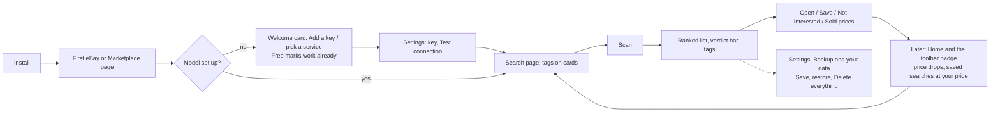

# Second Look: UX specification

Dated 2026-10-12, version 0.34.x. This spec describes the extension as built and the rules future changes keep to. Evidence labels: **Verified** means an automated check observed it on the real extension (headless Chrome 153.0.8010.52, Linux, synthetic eBay and Marketplace pages from `tests/fixtures` and `tests/e2e/server.ts`, a mock Claude API); **Implemented** means the code does it but no check watches it; **Not run** means nobody has looked yet.

The design direction is set: *minimal and elegant*, after the 0.13 "paper and ink" identity (warm paper, ink, hairlines, colour only for verdicts and one vermilion accent, the Fraunces serif for what you read).

## 1. The job

Someone shopping second-hand on eBay or Facebook Marketplace wants to know, without opening every listing: which ones are worth a look, which are overpriced next to what really sold, and which are scams. A reseller wants the same with a different question: which ones can be fixed and sold at a margin.

Second Look answers on the page itself (a tag on each card) and in a panel beside it (a ranked list). The core loop is **search → Scan → read the ranking → open, save or hide → come back later**.

## 2. Surfaces

| Surface | Size | What it's for | Why this surface |
|---|---|---|---|
| **Edge tab** | 34×~150px on the page edge (40px on hover); a count badge | Opening the panel; the number of new listings, or ★ listings at your price | Always there on eBay and Marketplace without covering anything |
| **Panel** (drawer) | 340 / 380 / 480px wide (S/M/L), `min(760px, 100vh − 48px)` tall; docks right or left | The ranked list, the controls, Saved and Home | Sustained work next to the page. A popup closes when you click the page, which is exactly when you need it |
| **Card tag** (sticker) | Pill, about 46px tall; the dial is 38px (48px on narrow cards) | Score, verdict, and the one line that matters (price vs sold, or the margin) | Judgment where you're already looking |
| **Hover card** | 264px | Why, the actions (Save, Sold ↗, Not interested), find the photo elsewhere | Detail on demand; reachable by Tab (the tag is focusable) |
| **Photo check card** | Panel-styled card | Result of a photo check | Feedback without leaving the listing |
| **Toolbar icon** | Chrome toolbar; badge | Open/close the panel (Alt+Shift+L), alerts count; right-click → Home | The standard extension entry point |
| **Settings** | Tab, 620px column | Model, spending, judging, filters, page options, backup and data | Long-lived configuration belongs in a full page |

**Alternatives considered** for the main surface (kept for the record):

| | Drawer in the page (chosen) | Chrome side panel | Popup |
|---|---|---|---|
| Stays open while you use the page | Yes | Yes | No, it closes on the first click |
| Can point at a card (scroll to it, flash it) | Yes | Only through messaging | No |
| Space | Overlays the page edge; tuck it away with Esc | Takes width from the page | Small |
| Cost | Built | A second UI to keep in step | Wrong for the job |

The side panel is still worth a prototype (it never covers eBay's layout); it's an open item, not a decision.

## 3. Journey

| Step | What the person sees | Primary action | Evidence |
|---|---|---|---|
| Install | Nothing opens; the tab appears on the next eBay or Marketplace page | — | Implemented |
| First open, no model | Welcome card: four steps; step 1 is *Add a Claude API key*, with **Open settings**. The free marks already work, and the card says so | Open settings | Verified (`audit.ts` first run, `a11y.test.js`) |
| Settings | Status card: *Ready: Sonnet 5.5, scans with Haiku 5.5* or what's missing; Model section first | Paste key → Test connection | Verified (`tests/options`, `features.ts`) |
| Search page | Free tags on every card (scam words, off-site contact, "for parts"); panel shows what it will compare and **Scan N listings · under 1¢** | Scan | Verified |
| Scanning | Status line *Ranking 6 listings with Haiku 5.5…*, spinner, **Stop**, a progress hairline under the tabs; the Scan button is disabled | Stop (optional) | Verified (`states.ts`) |
| Results | *2 worth a look*, the verdict bar, counts, Save search / Try on Marketplace / Start over; the ranked list; tags on the cards | Open the best one | Verified |
| Listing page | 60px dial, verdict, summary, suggested offer with a message to copy, questions for the seller | Copy message | Verified |
| Repeat use | Home: *Worth another look* (price drops, saved searches with listings at your price), getting started, spending | Open the alert | Verified (`features.ts`) |
| Leave | Settings › Backup and your data: Save a backup, Restore, **Delete everything** (asks first). Uninstalling also deletes everything | Delete everything | Verified (`states.ts`) |

## 4. States

Every message names what happened and what to do; where the fix is somewhere else, the message has a button that goes there. All of these are **Verified** by `tests/e2e/states.ts` unless marked.

| State | Where | Copy (exact) | Way out |
|---|---|---|---|
| No model yet | Welcome card / setup card | *Add a Claude API key to start.* | **Open settings** |
| Key rejected | Status line, error style | *The Claude API key was rejected. Check it in the extension options.* | **Open settings**; Scan stays in view to retry |
| Rate limit | Status line | *Claude API rate limit hit. Wait a moment and scan again.* (after two quiet retries) | Scan |
| Overloaded (529/5xx) | Status line | *The Claude API is overloaded right now. Try again in a minute.* | Scan (Implemented) |
| Answer cut off | Status line | *Claude's answer was cut off. Lower "Listings per request" in settings and try again.* | **Open settings** |
| Offline / unreachable | Status line | *Can't reach the Claude API. Check your internet connection.* | Scan |
| Budget used up | Status line; the footer amount turns red with *of $X* | *This month's budget of $X is used up (about $Y spent). Raise it in settings, or switch to Ollama in the panel's model menu.* | **Open settings**; the model menu in the footer |
| Address not allowed (Ollama, custom service) | Status line | *Second Look isn't allowed to reach … yet. In settings, press Test connection to allow it.* | **Open settings** → Test connection asks Chrome (Verified, `features.ts`) |
| Other services: no credit, unknown model | Status line | *… says the account is out of credit.* / *… doesn't recognise the model …* | **Open settings** (Implemented) |
| Scan under way | Status line, progress hairline, Stop | *Ranking N listings with {model}…* | **Stop** |
| Stopped | Status line | *Stopped. Ranked 0 of 6; the other 6 are offered again.* | Scan (only what's left) |
| Partial success | Status line | *Ranked 4 of 6 new listings…*; the ones not scored are offered again on the next Scan | Scan (Implemented) |
| Nothing to scan here | Panel opens on **Home**; This page says *Nothing to scan on this page. Open a search, a category or a listing…* | Open a search |
| Empty Saved | Saved | *Hover any card and press Save to keep it here, or save a search…* | — |
| Empty Home | Home | Getting started (n of 4) and *Nothing yet. Saved listings that get cheaper…* | The step's button |
| eBay pushes back on sold lookups | Status / note | Sold prices pause for an hour; scans continue without them (Verified, `features.ts`) | — |
| Extension updated under an open page | Status line | *Second Look was updated. Reload this page to keep using it.* | **Reload the page** (Implemented) |
| Photo can't be checked | Photo card | *Only photos from eBay and Facebook can be checked.* / *That photo is too large…* | — |

Truthfulness rules: costs are always *estimates* and say so; "free" is only used for things that never call a paid service; a cut-off or failed batch never shows a score it didn't get.

## 5. Tokens

Defined once in `content/panel.js` (`THEME_DARK`, `THEME_LIGHT`, `THEME_CSS`) and mirrored in `options/options.html`. Dark is the default when the browser doesn't say; Settings › Theme can force either. Card tags follow the *page's* measured brightness, not the panel's theme.

| Token | Light | Dark | Use |
|---|---|---|---|
| `--paper` | #FBFAF6 | #161513 | Surfaces |
| `--paper-2` | #F1EEE6 | #2B2925 | Tracks, tints, hover |
| `--raise` | #FFFFFF | #34312C | The chosen segment, the welcome card |
| `--ink` | #1B1A17 | #ECE9E2 | Text, primary button |
| `--muted` | #5C5850 | #A9A59B | Secondary text (≥ 4.5:1 on paper) |
| `--rule` | #DDD8CD | #34322D | Hairlines |
| `--line` | #77736A | #858176 | Control borders (≥ 3:1) |
| `--accent` | #C8461F | #E2673C | The chosen tab's line, the mark's dot, alerts, the chart's peak. Nothing else |
| `--v-great` / `good` / `fair` / `pass` / `suspicious` | #0A6B35 / #4A6500 / #85540A / #5C5850 / #B00020 | #5FD08B / #B5D36A / #E0B050 / #A9A59B / #FF8A80 | Verdicts only |

| Type | Face | Sizes |
|---|---|---|
| Read (wordmark, headlines, scores, prices, big numbers) | Fraunces 400/400i/600, bundled, added with the FontFace API | 15–24px (wordmark 19, headline 23, listing dial 23) |
| Operate (labels, buttons, body) | Atkinson Hyperlegible if installed, else the system UI face | 12–15px; nothing under 12px except the tag's short word (8px, decorative; the verdict is also in the tag's name) |

Shape and space: radius 12px (panel, cards), 7px (controls), 999px (pills, switches); hairlines 1px; panel padding 16px; rows 14px vertical; controls 38–42px tall (buttons), ≥ 24px (every target). Shadow only on floating things (panel, tags, hover card). Motion: 0.12–0.32s ease; the drawer slides, views fade 0.16s; nothing moves with *reduce motion*.

## 6. Components

| Component | Behaviour |
|---|---|
| Header | Mark, *Second Look*, help, settings, tuck away. It's the drag handle (drag to the other edge to dock there; double-click to reset) and a Tab stop: ←/→ choose the side, ↑/↓ the width |
| Tabs | Home · This page · Saved. Arrow keys move between them (roving tabindex); the chosen one has the vermilion line |
| Buyer / Reseller | A pill switch at the end of the tab row (radiogroup, arrow keys). Each mode keeps its own sort, skip handling and wants. The meaning is This page's first line and part of each button's name |
| Scan | The one primary button. Says the count and the estimated cost. Becomes a quiet *Scan again* when nothing is new |
| Better searches · Sold prices | Equal secondary buttons, side by side |
| Status line | One line, `role=status`. Errors in the verdict red with a left rule, and the fix button. Stop sits beside it while busy |
| Verdict bar | One segment per verdict, as wide as its count; `role=img` with the counts as its name |
| List row | Dial, title (scrolls to and flashes the card), verdict, why, price. The row you point at or Tab into is tinted and shows Open / Check photo / Save / Not interested |
| Filter bar | Sticky at the top of the list. Filter toggles words, price range, New only, Hide broken, deal price, and Show / Dim / Hide for skips. Enter or Esc folds it; the button keeps the count |
| Card tag | Focusable; hover or focus shows the hover card. Never covers Facebook's "Just listed" corner (top right on Marketplace) |
| Footer | Model menu (changes at once) and this month's spend, which opens the spending detail |

## 7. Accessibility acceptance criteria (WCAG 2.2 AA)

| Criterion | Check | Status |
|---|---|---|
| 1.1.1 Non-text content: icons are decorative or named; dials and the verdict bar have text names | `a11y.ts` reads Chrome's accessibility tree: no unnamed controls in any view | Verified |
| 1.3.1 Info and relationships: tabs, radiogroups, status, labels | Roles in the tree; `a11y.test.js` | Verified |
| 1.4.1 Use of colour: verdicts are also words; the bar has a text name; errors have a rule and words | Review + tree | Verified |
| 1.4.3 / 1.4.11 Contrast: text ≥ 4.5:1, controls ≥ 3:1, both themes | `audit.ts` measures every visible element | Verified |
| 1.4.4 / 1.4.10 Resize and reflow: 200% zoom, no sideways scroll; short windows keep the results | `a11y.ts` 700×450 viewport | Verified |
| 1.4.12 Text spacing | Not run |  |
| 1.4.13 Content on hover: the hover card shows on focus too and stays while hovered; Esc tucks the panel | `audit.ts` captures it by focusing a tag (a capture, not an assertion) | Implemented |
| 2.1.1 Keyboard: every action, including moving and resizing the panel | `a11y.ts` Tab walk; `a11y.test.js`; `ux.ts` | Verified |
| 2.4.3 Focus order; 2.4.7 Focus visible: every stop shows a ring | Tab walk checks a ring at every stop | Verified |
| 2.4.11 Focus not obscured: the sticky filter bar never covers the focused row | Not run (needs a check that tabs through a long list) |  |
| 2.5.8 Target size ≥ 24×24 | `audit.ts` | Verified |
| 3.3.1 Error identification: errors say what and where | `states.ts` | Verified |
| 4.1.3 Status messages: the status line, Saved's status and the search-ideas status are `role=status` | Roles present | Verified (role); a real screen reader is Not run |
| Forced colours (Windows high contrast) | `a11y.ts` emulation: chosen tab and mode stay marked; dials become circles | Verified (emulated) |
| Reduced motion | CSS media rule | Implemented |
| NVDA / JAWS / VoiceOver pass | — | **Not run** |

## 8. Screenshot targets and QA scenarios

Run on the real extension (`tests/e2e/run.sh <file>`; screenshots with the `*_OUT=dir` variable):

| Script | What it captures |
|---|---|
| `audit.ts` (`AUDIT_OUT`) | Every view in dark and light: first run, closed tab, before and after a scan, Reseller, card tags, hover card, filter and spend, search ideas, Saved, Home, listing, error, settings (full and 390px) — with contrast, target and type metrics |
| `a11y.ts` (`A11Y_OUT`) | Accessibility tree, Tab walk, forced colours, 200% zoom |
| `states.ts` (`STATES_OUT`) | Every state in section 4 that a mock can produce |
| `features.ts`, `ux.ts`, `marketplace.ts`, `scores-persist.ts`, `perf.ts` | Behaviour; `tests/all.sh` runs them all |

Not covered by automation, to check by hand in branded Chrome: the toolbar shortcut and badge, the right-click Home item, installing and updating over an open eBay tab (the *Reload the page* state), a real screen reader, and live eBay and Facebook pages (their markup changes without notice).

## 9. Open decisions

- A Chrome side panel prototype (section 2).
- Localisation: English only today; strings are inline. RTL is not applicable until there's a translation.
- Whether *Start over* should ask before clearing a page's scores (it clears only this page, and a rescan of remembered listings is free).
