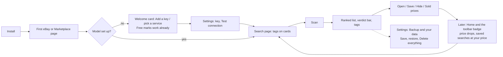

# Tirekick: UX specification

Dated 2026-10-12, version 0.34.x; brought up to date with the Tirekick name and the Tread Dot look in 0.36.0. This spec describes the extension as built and the rules future changes keep to. Evidence labels: **Verified** means an automated check observed it on the real extension (headless Chrome 153.0.8010.52, Linux, synthetic eBay and Marketplace pages from `tests/fixtures` and `tests/e2e/server.ts`, a mock Claude API); **Implemented** means the code does it but no check watches it; **Not run** means nobody has looked yet.

The design direction is set: *minimal and elegant*, in the Tread Dot look (a quiet slate navy dark and white light, hairlines, color as a cue: verdict colors on tags, rows and free reads, an orange main button in dark, Bricolage Grotesque throughout, and a score dot ringed with tread marks: 20 marks, one per 5 points, lit as far as the score, so a full ring of tread is a great deal).

## 1. The job

Someone shopping secondhand on eBay or Facebook Marketplace wants to know, without opening every listing: which ones are worth a look, which are overpriced next to what really sold, and which are scams. A reseller wants the same with a different question: which ones can be fixed and sold at a margin.

Tirekick answers on the page itself (a tag on each card) and in a panel beside it (a ranked list). The core loop is **search → Scan → read the ranking → open, save or hide → come back later**.

## 2. Surfaces

| Surface | Size | What it's for | Why this surface |
|---|---|---|---|
| **Edge tab** | 34×~150px on the page edge (40px on hover); a count badge | Opening the panel; the number of new listings, or ★ listings at your price | Always there on eBay and Marketplace without covering anything |
| **Panel** (drawer) | 340 / 380 / 480px wide (S/M/L), `min(760px, 100vh − 48px)` tall; docks right or left | The ranked list, the controls, Saved and Home | Sustained work next to the page. A popup closes when you click the page, which is exactly when you need it |
| **Card tag** (sticker) | Pill, about 46px tall; the score dot is 38px (48px on narrow cards) | Score, verdict, and the one line that matters (price vs sold, or the margin) | Judgment where you're already looking |
| **Hover card** | 264px | Why, the actions (Save, Typical price or Sold ↗, Hide), find the photo elsewhere | Detail on demand; reachable by Tab (the tag is focusable) |
| **Photo check card** | Panel-styled card | Result of a photo check | Feedback without leaving the listing |
| **Toolbar icon** | Chrome toolbar; badge | Open/close the panel (Alt+Shift+L), alerts count; right-click → Home | The standard extension entry point |
| **Settings** | Tab, 620px column | Model, spending, judging, filters, page options, backup and data | Long-lived configuration belongs in a full page |

**Alternatives considered** for the main surface (kept for the record):

| | Drawer in the page (chosen) | Chrome side panel | Popup |
|---|---|---|---|
| Stays open while you use the page | Yes | Yes | No, it closes on the first click |
| Can point at a card (scroll to it, flash it) | Yes | Only through messaging | No |
| Space | Overlays the page edge; tuck it away with Esc | Takes width from the page | Small |
| Cost | Built | A second UI to keep in step | Wrong for the job |

The side panel is still worth a prototype (it never covers eBay's layout); it's an open item, not a decision.

## 3. Journey

| Step | What the person sees | Primary action | Evidence |
|---|---|---|---|
| Install | Nothing opens; the tab appears on the next eBay or Marketplace page | — | Implemented |
| First open, no model | Welcome card: *Add an AI to start scoring* (any service the user has a key for, or a local model; none is pushed) with **Open settings**, then three short points (what Scan does, Buyer or Reseller, the tag's reasons) and that the free marks already work | Open settings | Verified (`audit.ts` first run) |
| Settings | Status card: *Ready: Sonnet 5.5, scans with Haiku 5.5*, *Ready: scam checks only*, *Ready: price checks and scam marks* (a fresh install: the AI is opt-in and starts off), or what's missing; then **What should Tirekick do?** (Without the AI, the default; Scam check only; Everything, with AI scores; Custom when the switches differ), then On the page | Paste key → Test connection | Verified (`tests/options`, `features.ts`) |
| Search page | Free tags on every card (scam words, off-site contact, "for parts"); the panel has one field (What I want), one line for the compare words (*Prices compared with sold "pentax k1000" · Change*) and **Scan N listings · under 1¢** | Scan | Verified |
| Scanning | Status line *Ranking 6 listings with Haiku 5.5…*, spinner, **Stop**, a progress hairline under the tabs; the Scan button is disabled | Stop (optional) | Verified (`states.ts`) |
| Results | *2 worth a look*, the verdict bar, counts, Save search / Try on Marketplace / Start over; the ranked list (a title shows the card on the page, **Open ↗** under the price opens it); tags on the cards | Open the best one | Verified |
| Listing page | 60px score dot, verdict, summary, suggested offer with a message to copy, questions for the seller | Copy message | Verified |
| Repeat use | Home leads the tabs: *Worth another look* first when there's something (price drops, saved searches at your price), then getting started, then numbers that open their lists; spending and usage are folded | Open the alert | Verified (`features.ts`) |
| Leave | Settings › Backup and your data: Save a backup, Restore, **Delete everything** (asks first). Uninstalling also deletes everything | Delete everything | Verified (`states.ts`) |

## 4. States

Every message names what happened and what to do; where the fix is somewhere else, the message has a button that goes there. All of these are **Verified** by `tests/e2e/states.ts` unless marked.

| State | Where | Copy (exact) | Way out |
|---|---|---|---|
| No model yet | Welcome card / setup card | *Add an AI to start scoring.* Lists services side by side, none first. | **Open settings** |
| Key rejected | Status line, error style | *The Claude API key was rejected. Check it in settings.* | **Open settings**; Scan stays in view to retry |
| Rate limit | Status line | *Claude API rate limit hit. Wait a moment and scan again.* (after two quiet retries) | Scan |
| Overloaded (529/5xx) | Status line | *The Claude API is overloaded right now. Try again in a minute.* | Scan (Implemented) |
| Answer cut off | Status line | *Claude's answer was cut off. Lower "Listings per request" in settings and try again.* | **Open settings** |
| Offline / unreachable | Status line | *Can't reach the Claude API. Check your internet connection.* | Scan |
| Budget used up | Status line; the footer amount turns red with *of $X* | *This month's budget of $X is used up (about $Y spent). Raise it in settings, or switch to Ollama in the panel's model menu.* | **Open settings**; the model menu in the footer |
| Address not allowed (Ollama, custom service) | Status line | *Tirekick isn't allowed to reach … yet. In settings, press Test connection to allow it.* | **Open settings** → Test connection asks Chrome (Verified, `features.ts`) |
| Other services: no credit, unknown model | Status line | *… says the account is out of credit.* / *… doesn't recognize the model …* | **Open settings** (Implemented) |
| Scan under way | Status line, progress hairline, Stop | *Ranking N listings with {model}…* | **Stop** |
| Stopped | Status line | *Stopped. Ranked 0 of 6; the other 6 are offered again.* | Scan (only what's left) |
| Partial success | Status line | *Ranked 4 of 6 new listings…*; the ones not scored are offered again on the next Scan | Scan (Implemented) |
| Nothing to scan here | Panel opens on **Home**; This page says *Nothing to scan on this page. Open a search, a category or a listing…* | Open a search |
| Empty Saved | Saved | *Hover any card and press Save to keep it here, or save a search…* | — |
| Empty Home | Home | Getting started (n of 4) and *Nothing new. Saved listings that get cheaper, and saved searches with listings at your price, show up here.* | The step's button |
| eBay pushes back on sold lookups | Status / note | Sold prices pause for an hour; scans continue without them (Verified, `features.ts`) | — |
| Extension updated under an open page | Status line | *Tirekick was updated. Reload this page to keep using it.* | **Reload the page** (Implemented) |
| Photo can't be checked | Photo card | *Only photos from eBay and Facebook can be checked.* / *That photo is too large…* | — |

Truthfulness rules: costs are always *estimates* and say so; "free" is only used for things that never call a paid service; a cut-off or failed batch never shows a score it didn't get.

## 5. Tokens

Defined once in `lib/theme.js` (`TKTheme.palette`, the type, the tread dot and the verdict glyphs), which the panel, the card tags, settings and Tirekick's own page all read. Dark is the default when the browser doesn't say; Settings › Theme can force either. Card tags follow the *page's* measured brightness, not the panel's theme.

| Token | Light | Dark | Use |
|---|---|---|---|
| `--paper` | #FFFFFF | #1C2433 | Surfaces |
| `--paper-2` | #F4F6F9 | #161D29 | Tracks, tints, hover |
| `--raise` | #FFFFFF | #232D3F | The chosen segment, the welcome card |
| `--ink` | #1A2B4C | #EDF0F5 | Text |
| `--muted` | #5B6780 | #A8B1C2 | Secondary text (≥ 4.5:1 on paper) |
| `--rule` | #E3E8F0 | #2D3749 | Hairlines |
| `--line` | #7A879E | #7B869A | Control borders (≥ 3:1) |
| `--btn` | #1A2B4C | #FF8F3A | The one primary button and switches that are on (orange on navy, navy on white) |
| `--accent` | #B04E0E | #FF8F3A | The chosen tab's line, alerts, the chart's peak. Nothing else |
| `--danger` | #B42318 | #FF8A80 | Errors and things that clear data |
| `--v-great` / `good` / `fair` / `pass` / `suspicious` | #12703C / #4D6B05 / #7D5C00 / #5B6780 / #B42318 | #5FE39A / #C3EA6E / #FFE16B / #A9B5CB / #FF8A80 | Verdict words |
| `--dot-great` … `--dot-suspicious` | #7CD3A2 / #C2DC86 / #F2D472 / #AEB8C9 / #F28B81 | #3BDB7E / #B6E35A / #FFE04A / #7D8BA6 / #FF6A5E | The score dot's fill |

| Type | Face | Sizes |
|---|---|---|
| Display (wordmark, headlines, scores, prices, big numbers) | Bricolage Grotesque as "TK Display": bundled, 85% width, weight 700–800 | 15–34px (settings and Home wordmark 34, headline 23, listing score 23) |
| Operate (labels, buttons, body) | Bricolage Grotesque as "TK Sans": the same bundled file, normal width | 12–15px; nothing under 12px except the tag's short word (8px, decorative; the verdict is also in the tag's name) |

Shape and space: radius 12px (panel, cards), 7px (controls), 999px (pills, switches); hairlines 1px; panel padding 16px; rows 14px vertical; controls 38–42px tall (buttons), ≥ 24px (every target). Shadow only on floating things (panel, tags, hover card). Motion: 0.12–0.32s ease; the drawer slides, views fade 0.16s; nothing moves with *reduce motion*.

## 6. Components

| Component | Behavior |
|---|---|
| Header | Mark, *Tirekick*, help, settings, tuck away. It's the drag handle (drag to the other edge to dock there; double-click to reset) and a Tab stop: ←/→ choose the side, ↑/↓ the width |
| Tabs | Home · This page · Saved. Arrow keys move between them (roving tabindex); the chosen one has the accent line |
| Buyer / Reseller | A pill switch at the end of the tab row (radiogroup, arrow keys). Each mode keeps its own sort, skip handling and wants. The meaning is This page's first line and part of each button's name |
| What I want / compare words | One field, What I want. The compare words come from the page's search and are one line with **Change** until changed; after a scan both fold into *Comparing "…" · wants …* with **Edit**, or **Add what you want** when it's empty |
| Mode hint | What the mode is for, as This page's first line: during your first three scans, and after a switch until the next scan |
| Scan | The one primary button. Says the count and the estimated cost. Becomes a quiet *Scan again* when nothing is new |
| Search ideas · Typical price | Equal secondary buttons, side by side |
| Status line | One line, `role=status`. Errors in the verdict red with a left rule, and the fix button. Stop sits beside it while busy |
| Verdict bar | One segment per verdict, as wide as its count; `role=img` with the counts as its name |
| List row | Score dot, title (scrolls to and flashes the card), verdict, why, price with **Open ↗** under it (always shown). The row you point at or Tab into is tinted and shows Check photo / Save / Hide |
| Filter bar | Sticky at the top of the list. One-click toggles in sight (New only, Hide broken, Hide accessories when there's a search, Hide off-topic, on by default on a feed with no search), Sort, and Skips and scams (Show / Dim / Hide). Filter opens words, price range and your price; Enter or Esc folds it, and a changed price goes to the store's own price filter (the tab reloads at the new address); **Apply on eBay** shows when a saved price isn't in the address; under the price, a row of the store's own filters (menus for choices of several, toggles for one), applied the same way; the button counts what's set inside |
| Free read | Before a scan, each row's verdict-colored word from free facts (`TKRules.freeRead`): price against sold, Check first, Likely scam, Off-topic. Orders "best first" until scores arrive |
| Card tag | Focusable; hover or focus shows the hover card. Never covers Facebook's "Just listed" corner: on Marketplace, where that label sits at the top left, the tag goes top right |
| Footer | The quality menu and this month's spend (opens the spending detail). With Claude the menu is **Thrifty** (Haiku for both), **Balanced** (Haiku scans, Sonnet for a single listing; the default) or **Thorough** (Sonnet scans, Opus): one choice sets both models, so what it shows is what scans use. Another pair from settings shows as *Custom*. Other services and Ollama are listed by model |
| Offer helper | On a listing page once sold prices are known, before any analysis: *Offer $270, walk away above $290*, the sales behind it (*From sold prices, no AI*), a message picked from three kinds (Friendly, Direct, With a reason) in a box you can edit, and **Copy message**. eBay listings with Make offer get the amount instead of a message. Nothing is typed into the site |
| Same-photo chip | *Same photo as 2 other listings* (warn), Marketplace only; its tooltip and the hover card say *a stolen or stock photo. Ask the seller for a photo with today's date.* A listing page says the same under the scam note |
| They said $ | Under the offer helper and the analysis's offer: a number field. *Take it at $285*, *Counter at $260* or *Offer $290 once, then walk away*, with the reason after a colon; the message box is rewritten to match |
| Price chip | The price against the typical price (the middle of recent eBay sales) in dollars, never a percentage and without the word "sold" on the card (dabloonery found both confusing): *Good price · $53 below typical*, *$20 above typical*, *about typical*; where "typical" comes from on hover (`TKRules.vsText`) |
| Too-cheap chip | *Likely scam: typical is $300* under 40% of a trusted median, *Too cheap? Typical is $300* under 55% (the % on hover); in place of the price chip. Not for broken ones, lots, auctions or a rough reference |
| Home tiles | Saved listings, price drops, saved searches and at your price; each opens Saved |

## 7. Accessibility acceptance criteria (WCAG 2.2 AA)

| Criterion | Check | Status |
|---|---|---|
| 1.1.1 Non-text content: icons are decorative or named; score dots and the verdict bar have text names | `a11y.ts` reads Chrome's accessibility tree: no unnamed controls in any view | Verified |
| 1.3.1 Info and relationships: tabs, radiogroups, status, labels | Roles in the tree; `a11y.test.js` | Verified |
| 1.4.1 Use of color: verdicts are also words; the bar has a text name; errors have a rule and words | Review + tree | Verified |
| 1.4.3 / 1.4.11 Contrast: text ≥ 4.5:1, controls ≥ 3:1, both themes | `audit.ts` measures every visible element | Verified |
| 1.4.4 / 1.4.10 Resize and reflow: 200% zoom, no sideways scroll; short windows keep the results | `a11y.ts` 700×450 viewport | Verified |
| 1.4.12 Text spacing | Not run |  |
| 1.4.13 Content on hover: the hover card shows on focus too and stays while hovered; Esc tucks the panel | `audit.ts` captures it by focusing a tag (a capture, not an assertion) | Implemented |
| 2.1.1 Keyboard: every action, including moving and resizing the panel | `a11y.ts` Tab walk; `a11y.test.js`; `ux.ts` | Verified |
| 2.4.3 Focus order; 2.4.7 Focus visible: every stop shows a ring | Tab walk checks a ring at every stop | Verified |
| 2.4.11 Focus not obscured: the sticky filter bar never covers the focused row | Not run (needs a check that tabs through a long list) |  |
| 2.5.8 Target size ≥ 24×24 | `audit.ts` | Verified |
| 3.3.1 Error identification: errors say what and where | `states.ts` | Verified |
| 4.1.3 Status messages: the status line, Saved's status and the search-ideas status are `role=status` | Roles present | Verified (role); a real screen reader is Not run |
| Forced colors (Windows high contrast) | `a11y.ts` emulation: chosen tab and mode stay marked; score dots become circles | Verified (emulated) |
| Reduced motion | CSS media rule | Implemented |
| NVDA / JAWS / VoiceOver pass | — | **Not run** |

## 8. Screenshot targets and QA scenarios

Run on the real extension (`tests/e2e/run.sh <file>`; screenshots with the `*_OUT=dir` variable):

| Script | What it captures |
|---|---|
| `audit.ts` (`AUDIT_OUT`) | Every view in dark and light: first run, closed tab, before and after a scan, Reseller, card tags, hover card, filter and spend, search ideas, Saved, Home, listing, error, settings (full and 390px) — with contrast, target and type metrics |
| `a11y.ts` (`A11Y_OUT`) | Accessibility tree, Tab walk, forced colors, 200% zoom |
| `states.ts` (`STATES_OUT`) | Every state in section 4 that a mock can produce |
| `features.ts`, `ux.ts`, `marketplace.ts`, `scores-persist.ts`, `perf.ts` | Behavior; `tests/all.sh` runs them all |

Not covered by automation, to check by hand in branded Chrome: the toolbar shortcut and badge, the right-click Home item, installing and updating over an open eBay tab (the *Reload the page* state), a real screen reader, and live eBay and Facebook pages (their markup changes without notice).

## 9. Review, 2026-10-13: what was confusing, and what changed

A pass over the whole workflow as a first-time and a returning user.

| Where | What was wrong | Change |
|---|---|---|
| Footer | It named one model (Sonnet 5.5), but scans, the thing you do most, used another (Haiku 5.5). Picking a model there didn't change scans | A quality menu: Thrifty, Balanced, Thorough. Each sets both models; the label says both |
| First run | Two onboardings: a four-step welcome on This page and four steps on Home, worded differently. The welcome's steps were things the panel already shows | The welcome is a key step (if needed) and three short points; Home keeps the checklist |
| Before a scan | Two text fields, one of which (Compare prices against) fills itself from the page and rarely needs touching | One field; the compare words are a line with Change (search and listing pages) |
| After a scan | *no wants set* told you what's missing | **Add what you want** offers it |
| Mode hint | Two lines on every visit, long after you know the modes | Only while new (first three scans) and right after a switch |
| Success status | *Ranked 6 of 6 new listings* restated the headline awkwardly | *Scored 6 new listings*; *Ranked x of y* only when some are missing |
| List rows | The only way to open a listing was a link that appears on hover | **Open ↗** under every price; the title still shows the card on the page |
| Filter | *Filter: dmg -case -game* and *Deal at ≤* were cryptic | *Words: working -parts* and *Your price ≤*, the words Home uses for it |
| Home | Setup came before news; four numbers that went nowhere; a spending chart and usage counters always open | What's new first; the numbers open their lists; spending and usage fold away |
| Non-search page | The panel opened on Saved | It opens on Home |
| Errors | Said *check it in settings* | Have **Open settings** (or **Reload the page**) |

Kept on purpose: the title scrolls to the card (preferred: seeing the card in its place, with Open as the explicit way to the listing), the hover-only row links (titles and prices lead; Tab reaches them), and Sold prices beside Scan (free, and useful before you spend anything).

## 10. Open decisions

- A Chrome side panel prototype (section 2).
- Localisation: English only today; strings are inline. RTL is not applicable until there's a translation.
- Whether *Start over* should ask before clearing a page's scores (it clears only this page, and a rescan of remembered listings is free).
